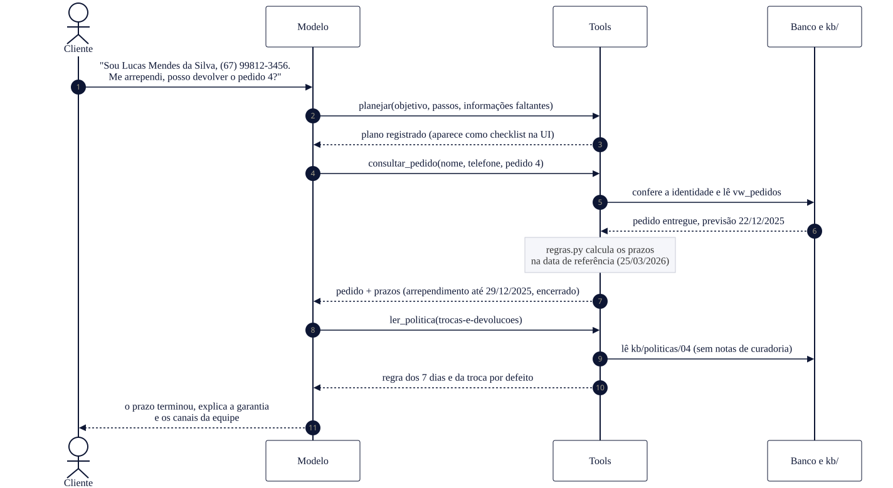

# Arquitetura

Como o agente funciona por dentro: de onde vêm as informações, como uma pergunta vira resposta e onde ficam as proteções. As justificativas de cada escolha estão em [`decisoes.md`](decisoes.md) (referências D01 a D23 e S01 a S07).

## Visão geral

O projeto tem duas fases:

1. **Preparação (offline):** os materiais da loja viram duas fontes confiáveis. Os CSVs passam por um ETL e viram um banco SQLite com dados tratados e verificados. O manual em PDF é extraído e curado em seções de Markdown revisadas.
2. **Atendimento (online):** a cada mensagem, o modelo decide quais ferramentas chamar, as ferramentas consultam o banco ou a base de políticas e devolvem dados já calculados, e o modelo escreve a resposta. O mesmo agente atende pelo terminal (CLI) e pela interface web.

A ideia central é **separar o que o modelo faz bem do que o código faz melhor**:

| O modelo decide | O código garante |
|---|---|
| O que o cliente quer e qual fonte consultar | Preços, PIX, parcelas e prazos, calculados com `Decimal` em `regras.py` |
| Em que ordem consultar (com plano explícito nas perguntas com várias etapas) | Verificação de identidade antes de mostrar um pedido |
| Como redigir a resposta no tom da loja | SQL somente leitura, restrito ao catálogo |
| | Limites de entrada, de consultas e de tentativas |

## Como uma pergunta vira resposta

Exemplo não trivial do enunciado, que exige dados e política juntos: um cliente que se arrependeu da compra.

1. O modelo recebe a mensagem com o prompt de sistema (persona, regras de qual fonte usar e o índice das políticas).
2. Como a pergunta precisa de mais de uma fonte, ele registra um plano com `planejar`. Na interface web, o plano vira um checklist que se completa em tempo real.
3. `consultar_pedido` só devolve o pedido se nome e telefone (ou e-mail) baterem com o cadastro. Junto com o pedido vêm os prazos de arrependimento, troca e garantia **já calculados** na data de referência, com o status de cada um (em aberto ou encerrado).
4. `ler_politica` entrega a seção de trocas e devoluções, sem as notas internas de curadoria.
5. O modelo junta as duas fontes e responde. Ele não refaz contas: repete os valores e as datas que vieram das ferramentas.

## Componentes

### 1. Dados e ETL (`etl/`)

`python -m etl.pipeline` lê `data/raw/` e reconstrói `data/emporio.db` do zero a cada execução. O banco é montado num arquivo temporário e só substitui o definitivo se todas as verificações de erro passarem.

| Camada | O que tem | Para quê |
|---|---|---|
| **Bronze** (`raw_*`) | Cópia fiel dos 6 CSVs, tudo como texto | Comparar origem e dado tratado em SQL, sem tocar nos arquivos originais |
| **Silver** | `products`, `promotions`, `product_prices`, `customers`, `orders`, `order_items`, `categories`, com tipos, chaves e `CHECK` | Dados tipados e padronizados, com colunas de flag de qualidade (`dq_*`) |
| **Gold** | Views `vw_catalogo` e `vw_pedidos` | O que as ferramentas leem: preço final, PIX, parcelas, disponibilidade, itens do pedido |
| Controle | `dq_results`, `etl_metadata` | Resultado de cada verificação e dados da execução |

**Qualidade de dados:** 6 verificações de **erro**, que bloqueiam a carga (chave duplicada, chave estrangeira órfã, domínio inválido...), e 15 de **alerta**, que são registradas e não bloqueiam (total de pedido divergente, produto ativo sem estoque, promoções duplicadas...). Inconsistências são **sinalizadas, não corrigidas em silêncio**: o valor original fica, e a flag e o tratamento ficam ao lado. O relatório [`data_quality.md`](data_quality.md) é gerado a cada execução e é determinístico: só muda no Git quando os dados ou as regras mudam.

**Regras de negócio num lugar só:** disponibilidade (status prevalece sobre estoque, S04), promoção vigente (com duas ativas, nenhuma vale, S06), PIX, parcelamento pelas faixas da seção 3.1 (S02) e prazos de pedido ficam em `src/agente/regras.py`. O ETL e as ferramentas importam as mesmas funções, então o relatório de qualidade e o agente nunca divergem sobre uma regra.

### 2. Base de conhecimento (`kb/`)

| Arquivo | Conteúdo | Quem lê |
|---|---|---|
| `politicas/01..09-*.md` | Uma seção do manual por arquivo, com cabeçalho (id, páginas de origem, público, quando consultar, status de revisão humana) | O agente, uma seção por vez, via `ler_politica` |
| `soul.md` | Persona, tom de voz, princípios inegociáveis e fluxo de atendimento | O agente, no prompt de sistema |
| `esquema/*.md` | Documentação das tabelas que o SQL livre pode ler | O agente, via `entender_esquema` |
| `index.md` | Índice para humanos | Quem mantém a base |
| `pendencias_gerencia.md` | 3 contradições e 10 lacunas do manual, com a decisão provisória | A gerência da loja (o agente não lê) |
| `_fonte/manual_extraido.md` | Texto bruto extraído do PDF | Base da curadoria e dos testes de fidelidade |

**Divulgação progressiva em vez de RAG vetorial:** o prompt traz só o índice das seções (gerado dos cabeçalhos), e o agente carrega a seção de que precisa. Com 9 seções curtas, isso é mais preciso que busca por similaridade, não corta regras ao meio e deixa auditável qual seção embasou cada resposta (D15).

**Dois tipos de nota:** blocos `> Orientação ao assistente` dizem ao agente como agir e chegam a ele. Blocos `> Nota de curadoria` registram de onde veio cada decisão e são removidos antes de chegar ao agente, então referências internas nunca aparecem para o cliente.

**Fidelidade testada:** `tests/test_kb.py` extrai todo valor verificável das seções (preços, percentuais, prazos, telefones, CEP, leis, e-mails) e confere que ele existe no PDF. Se a curadoria introduzir um valor que não está no manual, o teste falha.

### 3. Agente (`src/agente/`)

Construído com **Strands Agents**: loop ReAct com *function calling*. A cada passo o modelo escolhe uma ferramenta, recebe o resultado e decide se precisa de outra ou se já pode responder.

**Prompt de sistema** (`prompt.py`), montado nesta ordem:

1. persona e princípios (`kb/soul.md`, sem notas de curadoria);
2. tabela "a pergunta é sobre... → ferramenta" e regras de uso (responder sem executar ações, perguntar só o que falta, não refazer contas, não citar detalhes técnicos);
3. formato por canal: no CLI, texto puro de mensagem; na web, Markdown leve, sabendo que os cartões já mostram os dados;
4. índice das políticas, gerado dos cabeçalhos das seções;
5. data de referência dos pedidos. A hora atual não entra no prompt: vem da ferramenta `hora_atual_loja`, para nunca ficar desatualizada.

**Ferramentas** (`tools/`):

| Ferramenta | Lê | Devolve |
|---|---|---|
| `planejar` | nada | O plano registrado (objetivo, passos, informações que faltam). Só em perguntas com várias fontes |
| `buscar_produtos` | `vw_catalogo` | Lista filtrada por texto, categoria, faixa de preço, disponibilidade e promoção |
| `consultar_produto` | `vw_catalogo` | Um produto: preço, promoção vigente, PIX, parcelas, disponibilidade e, se indisponível, até 3 alternativas parecidas |
| `consultar_pedido` | `vw_pedidos`, `customers` | Pedido do titular verificado, com status, itens, rastreio, atraso e prazos de arrependimento, troca e garantia |
| `ler_politica` | `kb/politicas/` | Uma seção da política, sem notas de curadoria |
| `hora_atual_loja` | relógio (fuso de Campo Grande) | Se a loja está aberta agora e quando a equipe volta |
| `registrar_reclamacao` | `data/atendimento.db` | Protocolo `REC-AAAAMMDD-NNNN` e prazo de retorno (24 horas úteis) |
| `entender_esquema` | `kb/esquema/` | Documentação do banco, antes de montar SQL |
| `consultar_banco` | `vw_catalogo`, `categories` | Resultado de um SELECT somente leitura. Último recurso, para perguntas que as outras não cobrem |

**Memória:** o histórico da conversa fica no agente, com janela deslizante de 40 mensagens que preserva os pares chamada e resultado de ferramenta. No CLI, `--sessao <id>` grava a conversa em disco e permite retomá-la. Na web, cada aba do navegador tem a sua conversa.

**Provedor isolado:** `config.build_model()` é o único ponto que sabe qual provedor está em uso (Anthropic ou OpenRouter, escolhido no `.env`). Trocar de modelo não muda nenhuma outra linha de código.

### 4. Guardrails

O princípio é: **o prompt orienta, o código impede**. O que é crítico não depende de o modelo obedecer.

| Risco | Proteção | Onde |
|---|---|---|
| Expor pedido de outra pessoa | Nome completo **e** telefone ou e-mail idênticos ao cadastro. Se não conferir, a ferramenta não diz nem se o pedido existe. 3 falhas na conversa bloqueiam novas tentativas | `tools/pedidos.py` |
| SQL livre contornar a verificação de identidade | Conexão somente leitura, autorizador do SQLite que só permite ler `vw_catalogo` e `categories`, um comando por vez, até 50 linhas, interrupção de consultas longas, até 4 consultas por mensagem | `tools/sql.py` |
| Inventar preço, desconto ou prazo | Valores calculados no código e entregues prontos. Cartões da interface montados a partir do resultado das ferramentas, não do texto do modelo | `regras.py`, `ui/componentes.py` |
| Prompt injection ("ignore as instruções") | Princípio na persona. Mesmo que o modelo ceda, as ferramentas não expõem clientes nem pedidos sem verificação | `kb/soul.md`, tools |
| Mensagem gigante | Mensagens com mais de 2.000 caracteres não chegam ao modelo | `agente.py` |
| Falha do provedor | Erro classificado pelo código HTTP (chave, créditos, modelo recusado, limite, conexão). O cliente recebe uma mensagem amigável; o detalhe técnico vai só para o terminal. No máximo 3 tentativas por chamada | `agente.py` |
| Prometer o que o agente não faz | O agente responde e não executa ações. A única ação é registrar reclamação, que o manual exige (D22, D23) | `prompt.py`, `kb/soul.md` |
| Expor material interno | Notas de curadoria removidas; seções internas e textos das políticas não aparecem na interface | `kb.py`, `ui/componentes.py` |

### 5. Canais

- **CLI** (`python -m agente`): texto puro, como numa conversa de WhatsApp. Verifica a conexão com o modelo ao iniciar, tem `--debug` para ver as ferramentas usadas e `/exportar` para salvar a conversa em Markdown.
- **Web** (`streamlit run src/agente/ui/app.py`): cada resposta mostra, nesta ordem, o plano (quando há), os **cartões** com os dados consultados (produto, busca, pedido com prazos, horário, protocolo) e o texto do atendente. O progresso aparece em tempo real por *hooks* do Strands, que avisam quando cada ferramenta começa e termina. Todo valor que entra no HTML dos cartões é escapado.

### 6. Testes

| Nível | O que cobre | Como roda |
|---|---|---|
| ETL e regras (`test_etl.py`, `test_regras.py`) | Idempotência, contagens, flags nos casos conhecidos, cálculos de preço, parcelas e prazos | Banco temporário |
| Base de conhecimento (`test_kb.py`) | Estrutura, índice, fidelidade de cada valor ao PDF, remoção das notas internas | Leitura dos arquivos |
| Ferramentas (`test_tool_*.py`) | Contratos, guardrails de identidade e de SQL, alternativas, protocolo | Chamada direta, banco temporário |
| Agente (`test_agente.py`) | Loop de ferramentas, prompt, memória, falhas do provedor | Modelo roteirizado, sem API |
| Interface (`test_ui.py`) | Cartões, ordem da resposta, plano, cifrão, políticas ocultas | `AppTest` do Streamlit, sem navegador |
| Qualidade das respostas | 36 perguntas com fonte esperada, fatos obrigatórios e o que invalida a resposta | `tests/eval_set/perguntas.yaml` (etapa 6) |

São 216 testes automatizados. Nenhum precisa de chave de API: o loop do agente é testado com um modelo roteirizado (`tests/modelo_roteirizado.py`), que simula o modelo chamando ferramentas em sequência.
